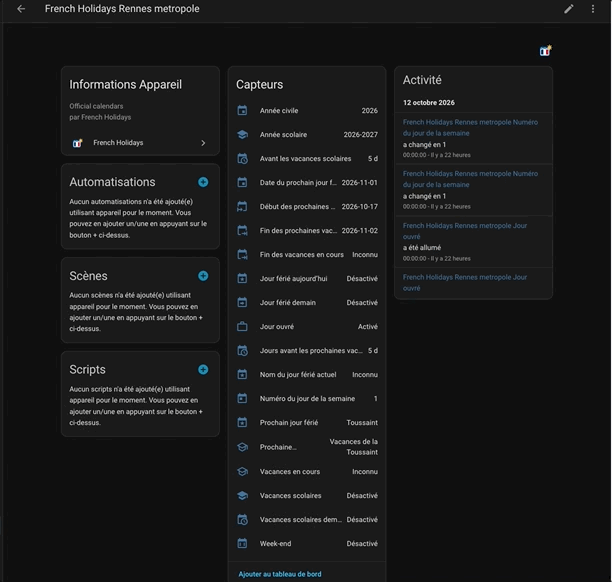

# French Holidays pour Home Assistant

*Le compteur mesure les téléchargements des fichiers joints aux releases GitHub. Il ne mesure pas le nombre d’utilisateurs ou d’installations, ni les téléchargements des archives de sources générées automatiquement. Avant la première release contenant un fichier joint, le badge peut être indisponible.*

**Vos jours fériés et vos vacances scolaires directement dans Home Assistant.**

French Holidays vous indique si aujourd’hui ou demain est un jour férié, si les
vacances scolaires sont en cours et quand commenceront les prochaines vacances.
Vous pouvez afficher ces informations sur votre tableau de bord ou les utiliser
pour adapter vos automatisations : réveil, chauffage, volets ou notifications.

L’intégration fonctionne sans Node-RED et sans MQTT. Elle se configure depuis
l’interface Home Assistant, sans ajouter de configuration YAML.

## Origine du projet

French Holidays est le portage pour Home Assistant du module Node-RED [node-red-french-holidays](https://github.com/tataille/node-red-french-holidays), développé par le même auteur.

Cette intégration reprend les informations et fonctionnalités du module original dans une implémentation native en Python, adaptée à Home Assistant. Elle fonctionne de manière autonome, sans nécessiter Node-RED ni MQTT. Le module Node-RED reste un projet distinct et disponible pour les utilisateurs de Node-RED.

## Ce que vous obtenez

- Les jours fériés d’aujourd’hui et de demain, le nom du jour férié actuel et le prochain jour férié.
- Les vacances scolaires d’aujourd’hui et de demain, le nom et la fin de la période en cours.
- Le nom, le début et la fin des prochaines vacances, avec un compte à rebours.
- Les indicateurs week-end et jour ouvré.
- Les informations de configuration : académie, région, zone et année scolaire.

**23 entités disponibles**, avec icônes et noms en français et en anglais.

## Aperçu des informations disponibles

*Illustration des informations disponibles, avec des valeurs d’exemple. Ce visuel n’est pas une capture d’écran de Home Assistant et ne correspond pas à une carte installée automatiquement. La présentation réelle dépend de votre tableau de bord et de votre thème.*

## Avant de commencer

- Home Assistant **2026.1 ou plus récent**.
- Un accès Internet pour télécharger les calendriers officiels au premier démarrage.
- HACS pour l’installation guidée, ou un accès au dossier de configuration pour l’installation manuelle.

Le projet est une intégration personnalisée en version **0.1.2**.
Il n’est pas intégré à Home Assistant Core ni référencé dans le catalogue HACS par défaut.

## Installer avec HACS

Le bouton ouvre ce dépôt dans HACS, qui doit déjà être installé. Vous pouvez aussi suivre les étapes ci-dessous.

1. Ouvrez **HACS**, puis le menu **⋮ → Dépôts personnalisés**.
2. Ajoutez `https://github.com/tataille/homeassistant-french-holidays` avec le type **Intégration**.
3. Recherchez **French Holidays** dans HACS et téléchargez l’intégration.
4. Redémarrez Home Assistant.
5. Ouvrez **Paramètres → Appareils et services → Ajouter une intégration** et recherchez **French Holidays**.

## Installer manuellement

1. [Téléchargez le projet](https://github.com/tataille/homeassistant-french-holidays/archive/refs/heads/main.zip) et décompressez l’archive.
2. Copiez le dossier `custom_components/french_holidays` dans le dossier de configuration de Home Assistant.
3. Vérifiez que vous obtenez le chemin `/config/custom_components/french_holidays/manifest.json`.
4. Redémarrez Home Assistant, puis ajoutez **French Holidays** dans **Paramètres → Appareils et services**.

Avec Home Assistant Docker, copiez les fichiers dans le dossier de l’hôte monté
sur `/config`. Ne copiez pas le dossier complet du dépôt dans `custom_components`.

## Choisir votre calendrier

L’intégration propose deux choix indépendants :

| Paramètre | À quoi sert-il ? | Exemple proposé par défaut |
|---|---|---|
| Académie | Détermine les vacances scolaires | Nantes — zone B |
| Région des jours fériés | Détermine les jours fériés | Martinique |

**Nantes + Martinique signifie : vacances scolaires de Nantes et jours fériés de Martinique.**
Ce choix ne sélectionne pas les vacances scolaires de Martinique.
Pour un usage local à Nantes, choisissez généralement Nantes et `metropole`.

Les régions proposées sont `metropole`, `alsace-moselle`, `guadeloupe`, `martinique`,
`guyane`, `la-reunion` et `mayotte`.

Pour changer votre combinaison dans cette version, supprimez l’entrée de l’intégration
puis ajoutez-la avec les nouveaux paramètres. Pour une simple mise à jour du code,
conservez l’entrée existante.

## Comprendre les capteurs

### Jours fériés et rythme de la semaine

| Entité | Signification |
|---|---|
| Jour férié aujourd’hui | Aujourd’hui est férié dans la région choisie |
| Jour férié demain | Demain est férié dans la région choisie |
| Nom du jour férié actuel | Nom du jour férié, uniquement lorsqu’aujourd’hui est férié |
| Prochain jour férié | Nom du premier jour férié strictement après aujourd’hui |
| Date du prochain jour férié | Date correspondante |
| Week-end | Aujourd’hui est samedi ou dimanche |
| Jour ouvré | Aujourd’hui est du lundi au vendredi et n’est pas férié |

L’indicateur « Jour ouvré » ne tient pas compte de votre contrat de travail,
de vos congés personnels ni des vacances scolaires.

### Vacances scolaires

| Entité | Signification |
|---|---|
| Vacances scolaires | Les vacances sont en cours aujourd’hui |
| Vacances scolaires demain | Les vacances seront en cours demain |
| Vacances en cours | Nom de la période actuelle |
| Fin des vacances en cours | Date de reprise des cours |
| Prochaines vacances scolaires | Nom de la prochaine période à commencer |
| Début des prochaines vacances | Premier jour de cette période |
| Fin des prochaines vacances | Date de reprise des cours après cette période |
| Avant les vacances scolaires | Zéro pendant les vacances ; sinon, jours avant la prochaine période |
| Jours avant les prochaines vacances | Jours avant la prochaine période, même pendant les vacances actuelles |

Les vacances sont comptées **par journée** : le jour de départ est inclus et le jour
de reprise est exclu. Le départ après la classe et le cas des élèves sans cours le
samedi ne sont pas gérés à l’heure près.

### Informations complémentaires

| Entité | Valeur |
|---|---|
| Numéro du jour de la semaine | Dimanche = 0, lundi = 1, …, samedi = 6 |
| Année civile | Par exemple 2026 |
| Année scolaire | Par exemple 2026-2027, avec changement au 1er septembre |
| Académie | Académie choisie |
| Région des jours fériés | Identifiant de la région choisie |
| Zone scolaire | Zone retournée par le calendrier officiel, par exemple Zone B |
| Version de l’intégration | Version Python installée |

L’académie, la région, la zone et la version sont regroupées parmi les entités de diagnostic.

## Afficher les informations sur votre tableau de bord

1. Ouvrez votre tableau de bord, puis **Modifier → Ajouter une carte**.
2. Choisissez une carte **Entités** ou **Tuile**.
3. Sélectionnez les entités de l’appareil **French Holidays**.
4. Pour une vue compacte, ajoutez le prochain jour férié, sa date, les prochaines vacances et le compteur.

Les identifiants des entités sont générés par Home Assistant. Retrouvez-les dans la
fiche de l’intégration ou dans **Outils de développement → États** avant de les utiliser
 dans une automatisation. Les couleurs et la présentation dépendent de votre thème et de la carte.

Pour une automatisation de réveil, vous pouvez par exemple ajouter une condition
sur **Jour ouvré = activé**, et éventuellement **Vacances scolaires = désactivé**.

## Exemples d’automatisation

Deux exemples YAML sont disponibles dans le [guide d’automatisation](docs/AUTOMATIONS.md) :

- notification de réveil à 07:00 les jours ouvrés, hors vacances scolaires ;
- consigne de chauffage du matin adaptée aux vacances scolaires.

Remplacez les identifiants d’entités par ceux de votre installation, puis adaptez les horaires, les actions et les températures. Ces exemples se configurent séparément et ne sont pas installés automatiquement.

## Mise à jour

Avec HACS, téléchargez la mise à jour proposée puis redémarrez Home Assistant.
Si aucune mise à jour n’apparaît, consultez le dépôt et l’option de retéléchargement de HACS.

Pour une installation manuelle, remplacez le dossier `custom_components/french_holidays`
par celui du projet actualisé puis redémarrez Home Assistant.

**Ne supprimez pas votre entrée de configuration pour mettre à jour de 0.1.0 à 0.1.1.**
Les dix entités déjà publiées conservent leurs identifiants uniques et treize capteurs sont ajoutés.
La compatibilité des identifiants d’une autre première version distribuée séparément n’est pas garantie.

## Questions fréquentes

**Le capteur affiche « Désactivé ». Est-ce une panne ?**

Pour un capteur binaire, l’état `off` signifie que la condition est fausse :
« Jour férié demain » désactivé signifie que demain n’est pas férié.
C’est différent d’une entité désactivée dans ses paramètres.

**Pourquoi certains capteurs sont-ils inconnus ?**

Le nom du jour férié actuel est inconnu hors jour férié ; le nom et la fin des vacances
actuelles sont inconnus hors vacances. Une prochaine période absente du calendrier
ou des données non encore chargées peuvent aussi produire un état inconnu.

**Que se passe-t-il si Internet tombe en panne ?**

Après un premier chargement réussi, les calendriers sont conservés dans un cache
persistant. L’intégration les réutilise et réessaie de joindre les sources.
L’attribut `cached_data` indique le recours au cache après un échec réseau.
Un calendrier dépassé peut produire des états inconnus. Sans cache au premier démarrage,
l’intégration réessaie de charger les données.

**À quelle fréquence les informations changent-elles ?**

Les données officielles sont téléchargées chaque jour. Les états sont recalculés
à minuit et vérifiés toutes les heures, selon le fuseau horaire de Home Assistant.
Les dates scolaires sont actuellement interprétées en Europe/Paris ; les académies
ultramarines doivent être vérifiées avant utilisation. Nantes est la configuration testée.

**L’intégration n’apparaît pas après installation.**

Vérifiez le chemin du dossier, redémarrez Home Assistant et rechargez la page.
Consultez ensuite **Paramètres → Système → Journaux** en recherchant `french_holidays`.

**Les noms restent en anglais ou une icône ne change pas.**

Vérifiez la langue de votre profil, redémarrez Home Assistant et rechargez l’interface.
Un nom ou une icône personnalisés manuellement dans Home Assistant peuvent prendre
le dessus sur ceux fournis par l’intégration.

## Soutenir le projet

Si French Holidays vous rend service, vous pouvez soutenir son développement et sa maintenance en m’offrant un café. Merci pour votre soutien !

## Sources officielles et assistance

- [Calendrier des jours fériés](https://calendrier.api.gouv.fr/)
- [Calendrier scolaire de l’Éducation nationale](https://data.education.gouv.fr/explore/dataset/fr-en-calendrier-scolaire/)
- [Signaler un problème ou proposer une amélioration](https://github.com/tataille/homeassistant-french-holidays/issues)

Pour un signalement, précisez votre version Home Assistant, la version de l’intégration,
l’académie et la région sélectionnées, et les messages du journal utiles au diagnostic.

Pour les utilisateurs du module original : [correspondance des champs Node-RED](docs/NODE_RED.md).
Pour contribuer au code : [guide de développement](docs/DEVELOPMENT.md).

Licence [Apache 2.0](LICENSE).
